# Khảo sát lựa chọn chứng chỉ tiếng Anh — sinh viên Tôn Đức Thắng

Tổng hợp toàn bộ **32 câu hỏi**, **89 phản hồi** tại thời điểm xuất dữ liệu 04/11/2026. Dữ liệu thực xuất từ bảng phản hồi liên kết Google Forms; không tạo dữ liệu giả.

## Phát hiện chính

- 60/89 sinh viên năm ba (67,42%): mẫu tập trung vào một nhóm năm học; chưa có thiết kế lấy mẫu nên không suy rộng toàn trường.
- Dự định thi IELTS: 33/89 (37,08%); chưa quyết định: 21/89 (23,60%).
- Kênh thông tin mạng xã hội/Internet: 71/89 (79,78%).
- Nhu cầu lộ trình học và ôn thi: 50/89 (56,18%).
- Có **12 cờ mâu thuẫn** theo quy tắc đã nêu; một người có thể mang nhiều cờ. Chỉ đánh dấu, không tự xoá.

## Phương pháp và giới hạn

Tần số câu đơn chia cho số trả lời không rỗng. Câu nhiều lựa chọn tính theo người trả lời câu, tổng % có thể vượt 100%. Giữ phân phối Likert 1–5, trung vị, trung bình và tỷ lệ mức 4–5. Chưa gán nhãn ý nghĩa từng mức khi chưa đối chiếu hướng dẫn thang đo gốc. Không gọi trung bình cao là tác động nhân quả; không chạy hồi quy/EFA hoặc Cronbach một cách tự động chỉ để có kết quả. Các mục có thể đo các khía cạnh khác nhau.

Tên khoa chỉ chuẩn hoá theo bảng mapping có thể kiểm tra. Khoa T giữ nguyên vì chưa đủ thông tin. Trình bày tần số nguyên trạng cho Q3; mapping là bảng bổ sung. Không tái nhận diện người trả lời. CSV gốc gồm thời gian và cột email nên giữ cục bộ; không tự công khai dữ liệu cá nhân lên GitHub.

## Đề xuất

Ưu tiên tài liệu so sánh chứng chỉ, lộ trình ôn thi và tư vấn theo trình độ/mục tiêu. Đối chiếu yêu cầu chuẩn đầu ra với quy định chính thức hiện hành trước khi tư vấn; khảo sát không xác minh quy định. Kiểm tra lại các câu mâu thuẫn nếu còn liên hệ được người trả lời theo quy trình khảo sát của bạn.

## Câu 1: Câu 1. Giới tính của bạn là gì?

Số trả lời: **89/89**.

| Lựa chọn | Số người/lượt chọn | % người trả lời câu |
|---|---:|---:|
| Nam | 48 | 53.93% |
| Nữ | 41 | 46.07% |

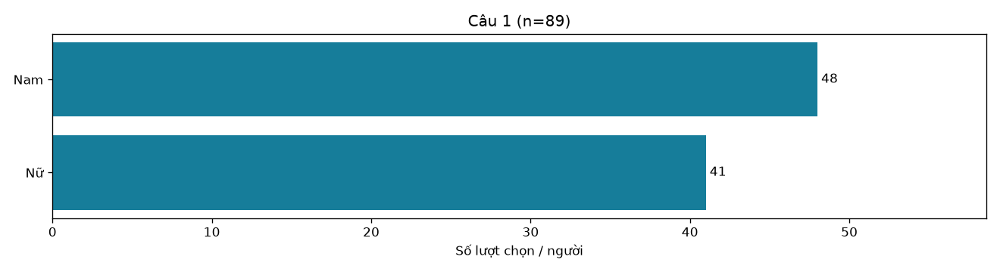

## Câu 2: Câu 2. Bạn đang là sinh viên năm mấy?

Số trả lời: **89/89**.

| Lựa chọn | Số người/lượt chọn | % người trả lời câu |
|---|---:|---:|
| Năm ba | 60 | 67.42% |
| Năm nhất | 7 | 7.87% |
| Năm hai | 7 | 7.87% |
| Năm tư trở lên | 15 | 16.85% |

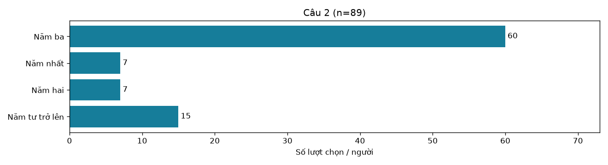

## Câu 3: Câu 3. Bạn đang học khoa nào?

Số trả lời: **89/89**.

| Lựa chọn | Số người/lượt chọn | % người trả lời câu |
|---|---:|---:|
| Khoa Toán -Thống kê | 41 | 46.07% |
| Khoa Quản trị kinh doanh | 9 | 10.11% |
| Khoa Công nghệ thông tin | 4 | 4.49% |
| Khoa Khoa học ứng dụng | 5 | 5.62% |
| Khoa Điện - Điện tử | 5 | 5.62% |
| Khoa Kỹ thuật công trình | 5 | 5.62% |
| Khoa Ngoại ngữ | 7 | 7.87% |
| Khoa Khoa học xã hội và Nhân văn | 2 | 2.25% |
| Khoa Luật | 2 | 2.25% |
| Khoa Khoa học thể thao | 3 | 3.37% |
| Khoa Kế toán | 2 | 2.25% |
| Khoa Dược | 2 | 2.25% |
| Khoa Mỹ thuật công nghiệp | 2 | 2.25% |

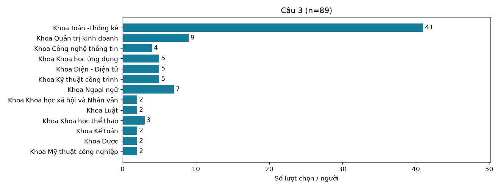

## Câu 4: Câu 4. Bạn đánh giá trình độ tiếng Anh của mình ở mức nào?

Số trả lời: **89/89**.

| Lựa chọn | Số người/lượt chọn | % người trả lời câu |
|---|---:|---:|
| Trung bình | 29 | 32.58% |
| Mới bắt đầu | 9 | 10.11% |
| Tốt | 19 | 21.35% |
| Cơ bản | 15 | 16.85% |
| Khá | 17 | 19.10% |

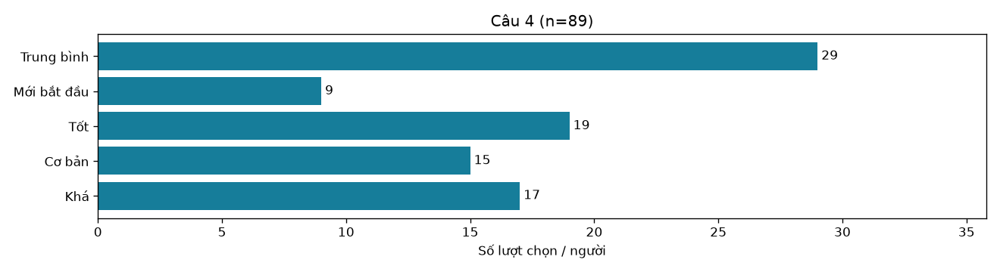

## Câu 5: Câu 5. Bạn đã từng ôn thi hoặc thi chứng chỉ tiếng Anh chưa?

Số trả lời: **89/89**.

| Lựa chọn | Số người/lượt chọn | % người trả lời câu |
|---|---:|---:|
| Chưa từng | 12 | 13.48% |
| Đã thi ít nhất một chứng chỉ | 59 | 66.29% |
| Đã học luyện thi nhưng chưa thi | 18 | 20.22% |

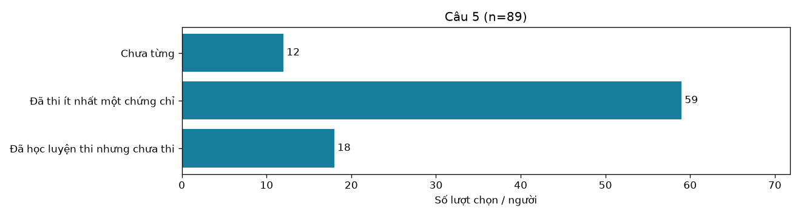

## Câu 6: Câu 6. Bạn đã từng thi chứng chỉ tiếng Anh nào? (Có thể chọn nhiều đáp án)

Số trả lời: **89/89**.

| Lựa chọn | Số người/lượt chọn | % người trả lời câu |
|---|---:|---:|
| APTIS | 59 | 66.29% |
| IELTS | 28 | 31.46% |
| Chưa thi chứng chỉ nào | 15 | 16.85% |
| TOEIC | 6 | 6.74% |
| Cambridge (PET) | 1 | 1.12% |
| Pet | 1 | 1.12% |
| PET Cambridge | 1 | 1.12% |

Câu nhiều lựa chọn: tỷ lệ chia cho số người trả lời câu; tổng tỷ lệ có thể vượt 100%. Tách theo dấu phẩy của Google Forms; giữ nhãn trống/khác trong dữ liệu gốc để rà soát.

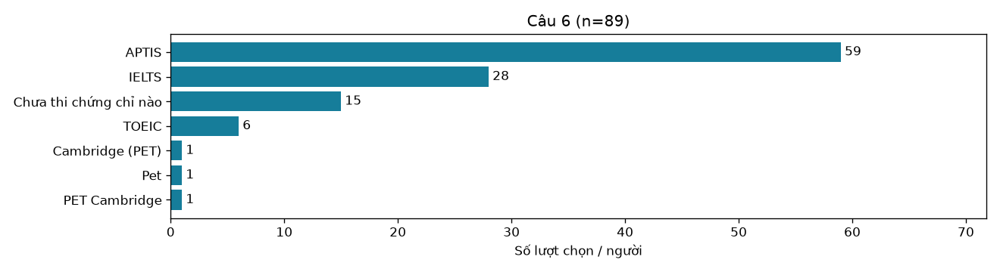

## Câu 7: Câu 7. Bạn dự định thi chứng chỉ nào trong thời gian tới?

Số trả lời: **89/89**.

| Lựa chọn | Số người/lượt chọn | % người trả lời câu |
|---|---:|---:|
| IELTS | 33 | 37.08% |
| Chưa có dự định hoặc chưa quyết định | 21 | 23.60% |
| APTIS | 15 | 16.85% |
| TOEIC | 18 | 20.22% |
| PET | 1 | 1.12% |
| PTE | 1 | 1.12% |

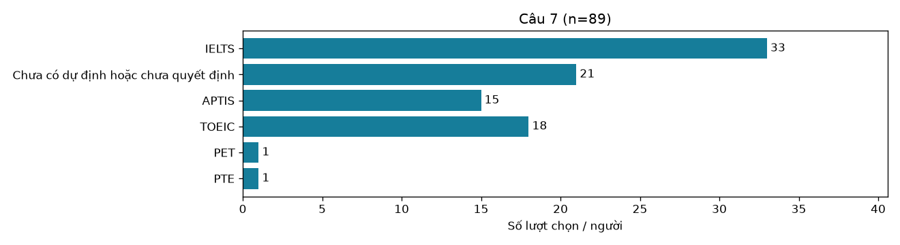

## Câu 8: Câu 8. Bạn muốn thi chứng chỉ tiếng Anh để làm gì? (Có thể chọn nhiều đáp án)

Số trả lời: **89/89**.

| Lựa chọn | Số người/lượt chọn | % người trả lời câu |
|---|---:|---:|
| Đáp ứng điều kiện tốt nghiệp | 50 | 56.18% |
| Phục vụ học tập | 52 | 58.43% |
| Xin việc hoặc phát triển nghề nghiệp | 58 | 65.17% |
| Du học | 25 | 28.09% |
| Phát triển bản thân | 47 | 52.81% |
| không thi | 1 | 1.12% |

Câu nhiều lựa chọn: tỷ lệ chia cho số người trả lời câu; tổng tỷ lệ có thể vượt 100%. Tách theo dấu phẩy của Google Forms; giữ nhãn trống/khác trong dữ liệu gốc để rà soát.

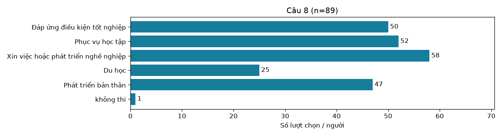

## Câu 9: Câu 9. Bạn dự định thi chứng chỉ khi nào?

Số trả lời: **89/89**.

| Lựa chọn | Số người/lượt chọn | % người trả lời câu |
|---|---:|---:|
| Sau hơn 12 tháng | 18 | 20.22% |
| Chưa xác định | 25 | 28.09% |
| Trong 6–12 tháng tới | 19 | 21.35% |
| Trong 6 tháng tới | 27 | 30.34% |

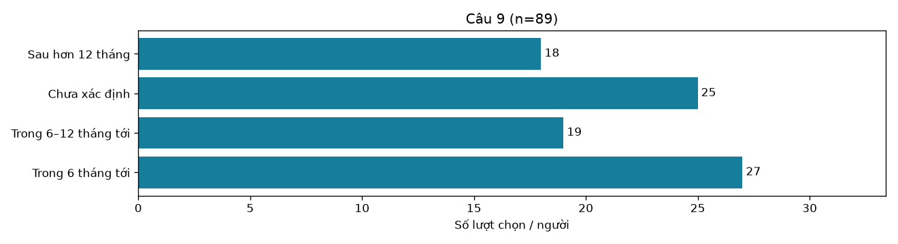

## Câu 10: Câu 10. Bạn tìm thông tin về chứng chỉ từ đâu? (Có thể chọn nhiều đáp án)

Số trả lời: **89/89**.

| Lựa chọn | Số người/lượt chọn | % người trả lời câu |
|---|---:|---:|
| Bạn bè hoặc người thân | 43 | 48.31% |
| Trung tâm ngoại ngữ | 42 | 47.19% |
| Mạng xã hội hoặc Internet | 71 | 79.78% |
| Giảng viên | 17 | 19.10% |
| Nhà trường hoặc khoa | 19 | 21.35% |

Câu nhiều lựa chọn: tỷ lệ chia cho số người trả lời câu; tổng tỷ lệ có thể vượt 100%. Tách theo dấu phẩy của Google Forms; giữ nhãn trống/khác trong dữ liệu gốc để rà soát.

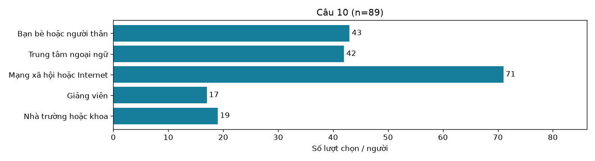

## Câu 11: Yếu tố cá nhân [11. Mục tiêu nghề nghiệp]

Số trả lời: **89/89**.

Trung bình **4.11/5**, trung vị **4**, chọn mức 4–5 **76.4%**. Trung bình là mô tả bổ sung cho thang thứ bậc.

| Lựa chọn | Số người/lượt chọn | % người trả lời câu |
|---|---:|---:|
| 1 | 4 | 4.49% |
| 2 | 4 | 4.49% |
| 3 | 13 | 14.61% |
| 4 | 25 | 28.09% |
| 5 | 43 | 48.31% |

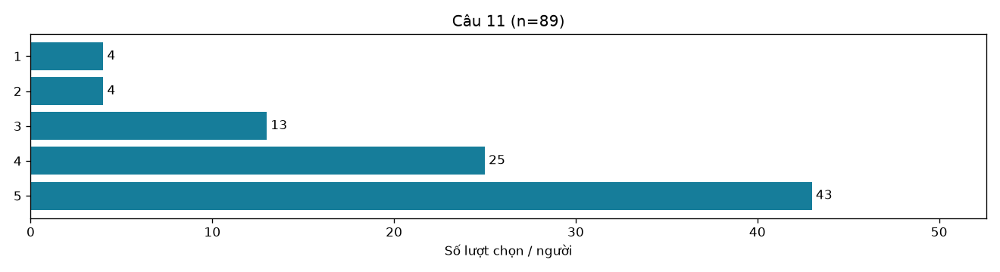

## Câu 12: Yếu tố cá nhân [12. Nhu cầu sử dụng tiếng Anh]

Số trả lời: **89/89**.

Trung bình **4.08/5**, trung vị **4**, chọn mức 4–5 **70.8%**. Trung bình là mô tả bổ sung cho thang thứ bậc.

| Lựa chọn | Số người/lượt chọn | % người trả lời câu |
|---|---:|---:|
| 1 | 3 | 3.37% |
| 2 | 3 | 3.37% |
| 3 | 20 | 22.47% |
| 4 | 21 | 23.60% |
| 5 | 42 | 47.19% |

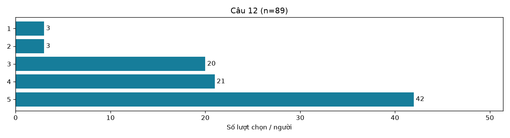

## Câu 13: Yếu tố cá nhân [13. Sự phù hợp của bài thi với trình độ tiếng Anh của bạn]

Số trả lời: **89/89**.

Trung bình **3.91/5**, trung vị **4**, chọn mức 4–5 **64.0%**. Trung bình là mô tả bổ sung cho thang thứ bậc.

| Lựa chọn | Số người/lượt chọn | % người trả lời câu |
|---|---:|---:|
| 1 | 3 | 3.37% |
| 2 | 2 | 2.25% |
| 3 | 27 | 30.34% |
| 4 | 25 | 28.09% |
| 5 | 32 | 35.96% |

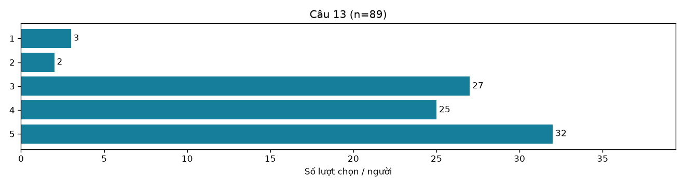

## Câu 14: Đặc điểm của chứng chỉ [14. Độ khó của bài thi]

Số trả lời: **89/89**.

Trung bình **3.82/5**, trung vị **4**, chọn mức 4–5 **58.4%**. Trung bình là mô tả bổ sung cho thang thứ bậc.

| Lựa chọn | Số người/lượt chọn | % người trả lời câu |
|---|---:|---:|
| 1 | 3 | 3.37% |
| 2 | 3 | 3.37% |
| 3 | 31 | 34.83% |
| 4 | 22 | 24.72% |
| 5 | 30 | 33.71% |

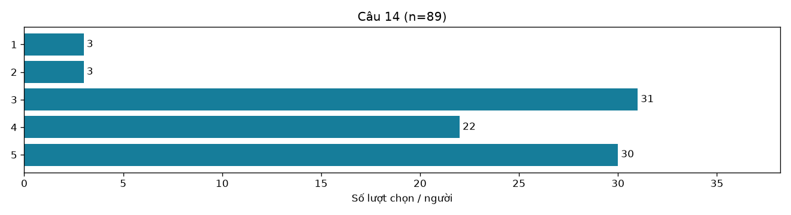

## Câu 15: Đặc điểm của chứng chỉ [15. Các kỹ năng và dạng câu hỏi trong bài thi]

Số trả lời: **89/89**.

Trung bình **3.81/5**, trung vị **4**, chọn mức 4–5 **58.4%**. Trung bình là mô tả bổ sung cho thang thứ bậc.

| Lựa chọn | Số người/lượt chọn | % người trả lời câu |
|---|---:|---:|
| 1 | 5 | 5.62% |
| 2 | 1 | 1.12% |
| 3 | 31 | 34.83% |
| 4 | 21 | 23.60% |
| 5 | 31 | 34.83% |

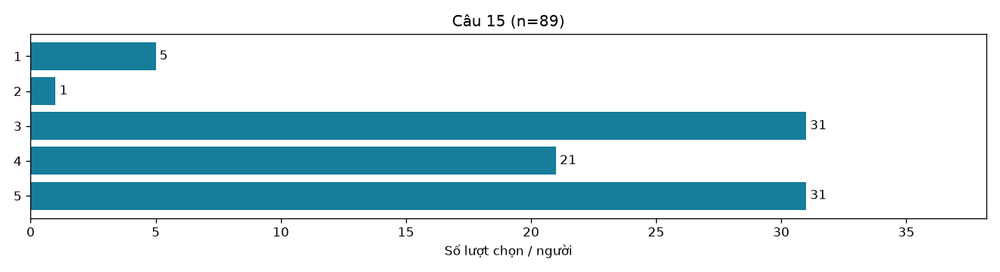

## Câu 16: Đặc điểm của chứng chỉ [16. Thời lượng bài thi và lịch thi]

Số trả lời: **89/89**.

Trung bình **3.70/5**, trung vị **4**, chọn mức 4–5 **58.4%**. Trung bình là mô tả bổ sung cho thang thứ bậc.

| Lựa chọn | Số người/lượt chọn | % người trả lời câu |
|---|---:|---:|
| 1 | 3 | 3.37% |
| 2 | 5 | 5.62% |
| 3 | 29 | 32.58% |
| 4 | 31 | 34.83% |
| 5 | 21 | 23.60% |

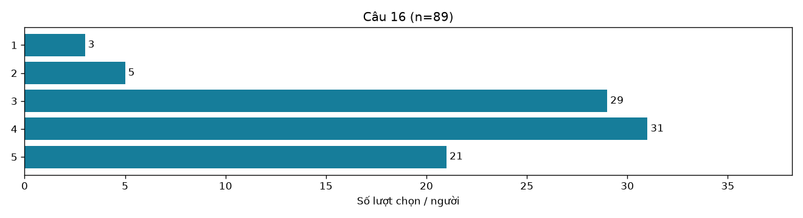

## Câu 17: Đặc điểm của chứng chỉ [17. Khả năng đạt điểm mong muốn]

Số trả lời: **89/89**.

Trung bình **3.83/5**, trung vị **4**, chọn mức 4–5 **64.0%**. Trung bình là mô tả bổ sung cho thang thứ bậc.

| Lựa chọn | Số người/lượt chọn | % người trả lời câu |
|---|---:|---:|
| 1 | 4 | 4.49% |
| 2 | 2 | 2.25% |
| 3 | 26 | 29.21% |
| 4 | 30 | 33.71% |
| 5 | 27 | 30.34% |

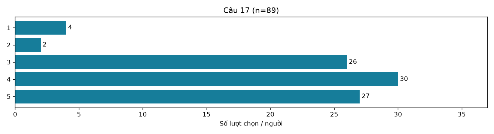

## Câu 18: Chi phí [18. Lệ phí thi]

Số trả lời: **89/89**.

Trung bình **3.70/5**, trung vị **4**, chọn mức 4–5 **60.7%**. Trung bình là mô tả bổ sung cho thang thứ bậc.

| Lựa chọn | Số người/lượt chọn | % người trả lời câu |
|---|---:|---:|
| 1 | 9 | 10.11% |
| 2 | 3 | 3.37% |
| 3 | 23 | 25.84% |
| 4 | 25 | 28.09% |
| 5 | 29 | 32.58% |

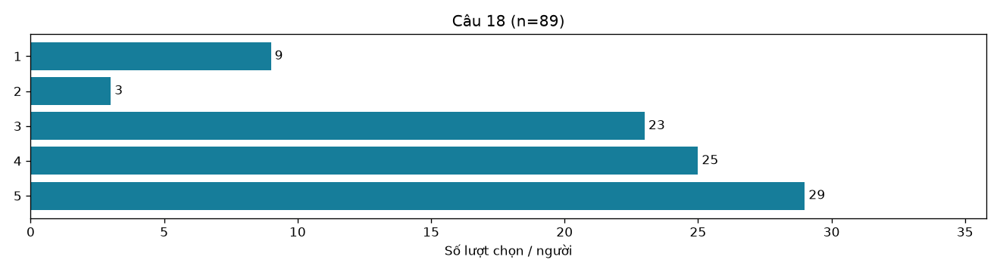

## Câu 19: Chi phí [19. Chi phí luyện thi]

Số trả lời: **89/89**.

Trung bình **3.76/5**, trung vị **4**, chọn mức 4–5 **58.4%**. Trung bình là mô tả bổ sung cho thang thứ bậc.

| Lựa chọn | Số người/lượt chọn | % người trả lời câu |
|---|---:|---:|
| 1 | 6 | 6.74% |
| 2 | 6 | 6.74% |
| 3 | 25 | 28.09% |
| 4 | 18 | 20.22% |
| 5 | 34 | 38.20% |

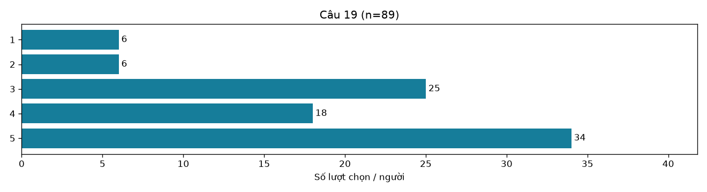

## Câu 20: Chi phí [20. Khả năng tài chính của bản thân hoặc gia đình]

Số trả lời: **89/89**.

Trung bình **3.66/5**, trung vị **4**, chọn mức 4–5 **58.4%**. Trung bình là mô tả bổ sung cho thang thứ bậc.

| Lựa chọn | Số người/lượt chọn | % người trả lời câu |
|---|---:|---:|
| 1 | 8 | 8.99% |
| 2 | 5 | 5.62% |
| 3 | 24 | 26.97% |
| 4 | 24 | 26.97% |
| 5 | 28 | 31.46% |

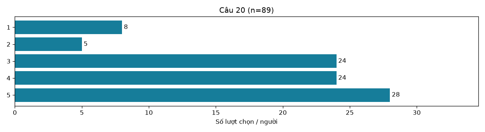

## Câu 21: Ý kiến và thông tin từ người khác [21. Sự giới thiệu của bạn bè]

Số trả lời: **89/89**.

Trung bình **3.56/5**, trung vị **4**, chọn mức 4–5 **53.9%**. Trung bình là mô tả bổ sung cho thang thứ bậc.

| Lựa chọn | Số người/lượt chọn | % người trả lời câu |
|---|---:|---:|
| 1 | 6 | 6.74% |
| 2 | 6 | 6.74% |
| 3 | 29 | 32.58% |
| 4 | 28 | 31.46% |
| 5 | 20 | 22.47% |

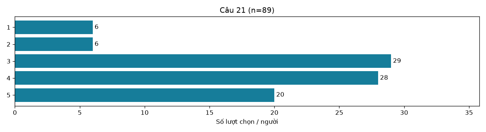

## Câu 22: Ý kiến và thông tin từ người khác [22. Ý kiến của giảng viên]

Số trả lời: **89/89**.

Trung bình **3.65/5**, trung vị **4**, chọn mức 4–5 **58.4%**. Trung bình là mô tả bổ sung cho thang thứ bậc.

| Lựa chọn | Số người/lượt chọn | % người trả lời câu |
|---|---:|---:|
| 1 | 7 | 7.87% |
| 2 | 4 | 4.49% |
| 3 | 26 | 29.21% |
| 4 | 28 | 31.46% |
| 5 | 24 | 26.97% |

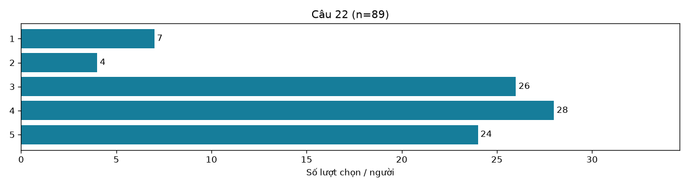

## Câu 23: Ý kiến và thông tin từ người khác [23. Thông tin trên mạng xã hội]

Số trả lời: **89/89**.

Trung bình **3.56/5**, trung vị **4**, chọn mức 4–5 **52.8%**. Trung bình là mô tả bổ sung cho thang thứ bậc.

| Lựa chọn | Số người/lượt chọn | % người trả lời câu |
|---|---:|---:|
| 1 | 7 | 7.87% |
| 2 | 5 | 5.62% |
| 3 | 30 | 33.71% |
| 4 | 25 | 28.09% |
| 5 | 22 | 24.72% |

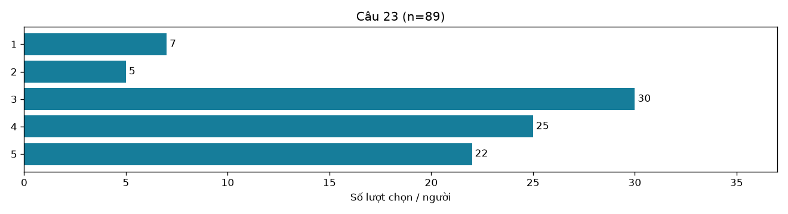

## Câu 24: Ý kiến và thông tin từ người khác [24. Tư vấn từ trung tâm ngoại ngữ]

Số trả lời: **89/89**.

Trung bình **3.40/5**, trung vị **3**, chọn mức 4–5 **44.9%**. Trung bình là mô tả bổ sung cho thang thứ bậc.

| Lựa chọn | Số người/lượt chọn | % người trả lời câu |
|---|---:|---:|
| 1 | 8 | 8.99% |
| 2 | 10 | 11.24% |
| 3 | 31 | 34.83% |
| 4 | 18 | 20.22% |
| 5 | 22 | 24.72% |

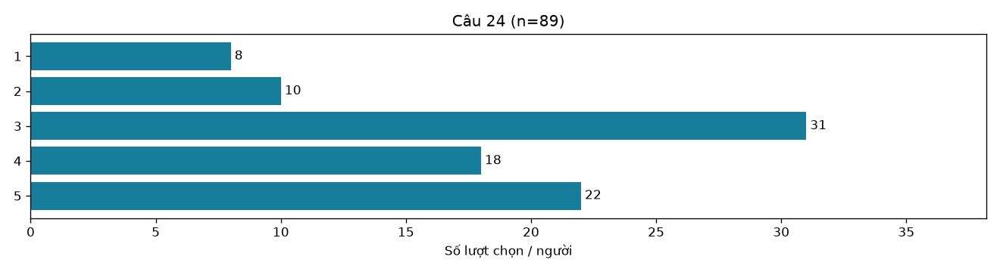

## Câu 25: Yếu tố từ nhà trường [25. Yêu cầu chuẩn đầu ra tiếng Anh]

Số trả lời: **89/89**.

Trung bình **3.82/5**, trung vị **4**, chọn mức 4–5 **65.2%**. Trung bình là mô tả bổ sung cho thang thứ bậc.

| Lựa chọn | Số người/lượt chọn | % người trả lời câu |
|---|---:|---:|
| 1 | 8 | 8.99% |
| 2 | 5 | 5.62% |
| 3 | 18 | 20.22% |
| 4 | 22 | 24.72% |
| 5 | 36 | 40.45% |

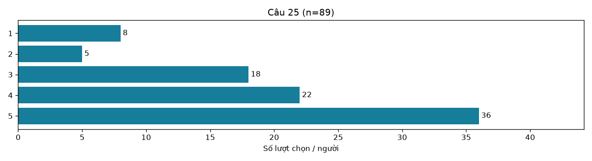

## Câu 26: Yếu tố từ nhà trường [26. Thông tin và tư vấn từ nhà trường]

Số trả lời: **89/89**.

Trung bình **3.47/5**, trung vị **3**, chọn mức 4–5 **49.4%**. Trung bình là mô tả bổ sung cho thang thứ bậc.

| Lựa chọn | Số người/lượt chọn | % người trả lời câu |
|---|---:|---:|
| 1 | 9 | 10.11% |
| 2 | 8 | 8.99% |
| 3 | 28 | 31.46% |
| 4 | 20 | 22.47% |
| 5 | 24 | 26.97% |

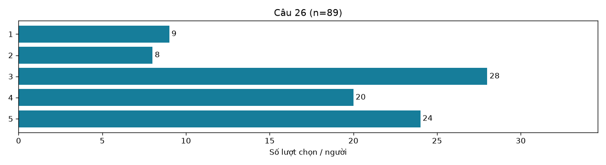

## Câu 27: Yếu tố từ nhà trường [27. Việc chứng chỉ được nhà trường công nhận]

Số trả lời: **89/89**.

Trung bình **3.87/5**, trung vị **4**, chọn mức 4–5 **67.4%**. Trung bình là mô tả bổ sung cho thang thứ bậc.

| Lựa chọn | Số người/lượt chọn | % người trả lời câu |
|---|---:|---:|
| 1 | 8 | 8.99% |
| 2 | 3 | 3.37% |
| 3 | 18 | 20.22% |
| 4 | 24 | 26.97% |
| 5 | 36 | 40.45% |

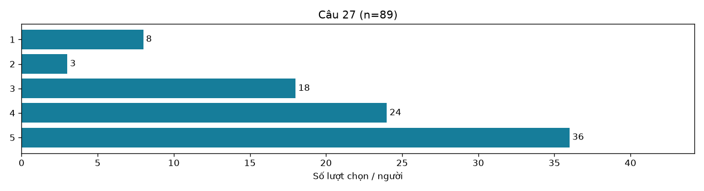

## Câu 28: Câu 28. Chứng chỉ bạn đã chọn hoặc dự định thi phù hợp với bạn ở mức nào?

Số trả lời: **89/89**.

| Lựa chọn | Số người/lượt chọn | % người trả lời câu |
|---|---:|---:|
| Phù hợp | 36 | 40.45% |
| Rất không phù hợp | 4 | 4.49% |
| Rất phù hợp | 23 | 25.84% |
| Bình thường | 20 | 22.47% |
| Chưa chọn chứng chỉ | 6 | 6.74% |

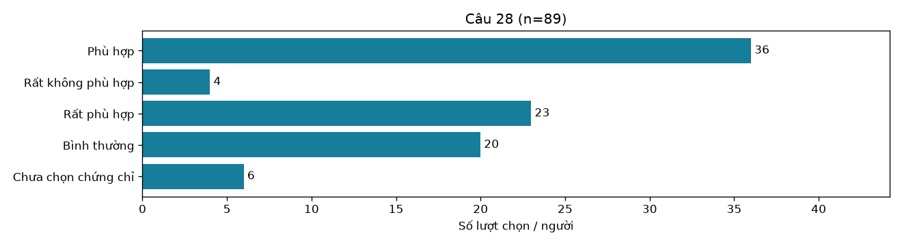

## Câu 29: Câu 29. Bạn có muốn giới thiệu chứng chỉ này cho sinh viên khác không?

Số trả lời: **89/89**.

| Lựa chọn | Số người/lượt chọn | % người trả lời câu |
|---|---:|---:|
| Chắc chắn có | 23 | 25.84% |
| Chắc chắn không | 5 | 5.62% |
| Chưa chắc | 11 | 12.36% |
| Có lẽ có | 42 | 47.19% |
| Chưa chọn chứng chỉ | 7 | 7.87% |
| Có lẽ không | 1 | 1.12% |

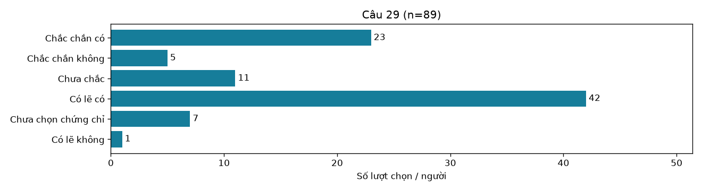

## Câu 30: Câu 30. Bạn gặp khó khăn gì khi chọn chứng chỉ? (Có thể chọn nhiều đáp án)

Số trả lời: **89/89**.

| Lựa chọn | Số người/lượt chọn | % người trả lời câu |
|---|---:|---:|
| Chi phí học hoặc thi cao | 32 | 35.96% |
| Lo ngại độ khó hoặc khả năng đạt điểm | 42 | 47.19% |
| Thiếu thông tin để so sánh các chứng chỉ | 20 | 22.47% |
| Không gặp khó khăn | 23 | 25.84% |
| Khó đánh giá chứng chỉ nào phù hợp với năng lực | 34 | 38.20% |
| Chưa rõ yêu cầu chuẩn đầu ra | 15 | 16.85% |

Câu nhiều lựa chọn: tỷ lệ chia cho số người trả lời câu; tổng tỷ lệ có thể vượt 100%. Tách theo dấu phẩy của Google Forms; giữ nhãn trống/khác trong dữ liệu gốc để rà soát.

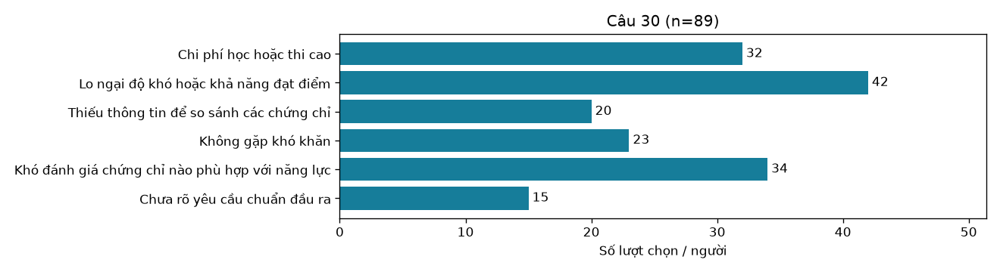

## Câu 31: Câu 31. Bạn muốn nhà trường cung cấp thông tin gì? (Có thể chọn nhiều đáp án)

Số trả lời: **89/89**.

| Lựa chọn | Số người/lượt chọn | % người trả lời câu |
|---|---:|---:|
| So sánh IELTS | 37 | 41.57% |
| TOEIC và APTIS | 37 | 41.57% |
| Quy định công nhận chứng chỉ và chuẩn đầu ra | 40 | 44.94% |
| Lộ trình học và ôn thi | 50 | 56.18% |
| Tư vấn chọn chứng chỉ theo mục tiêu cá nhân | 40 | 44.94% |
| Thông tin chi phí và địa điểm thi | 34 | 38.20% |
| không cần | 1 | 1.12% |

Câu nhiều lựa chọn: tỷ lệ chia cho số người trả lời câu; tổng tỷ lệ có thể vượt 100%. Tách theo dấu phẩy của Google Forms; giữ nhãn trống/khác trong dữ liệu gốc để rà soát.

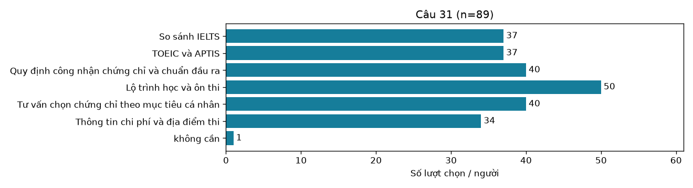

## Câu 32: Câu 32. Bạn có góp ý gì để giúp sinh viên chọn chứng chỉ phù hợp?

Số trả lời: **51/89**.

Có 51 phản hồi không rỗng; 17 phản hồi còn lại sau khi loại các câu không có góp ý theo danh sách quy tắc. Đây là phân loại hỗ trợ, cần đọc lại thủ công. Không tự coi 51 câu trả lời là 51 góp ý có nội dung.

Không công khai nguyên văn góp ý để bảo vệ thông tin người trả lời.
